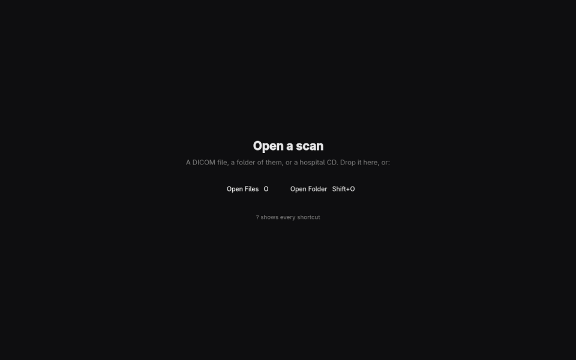
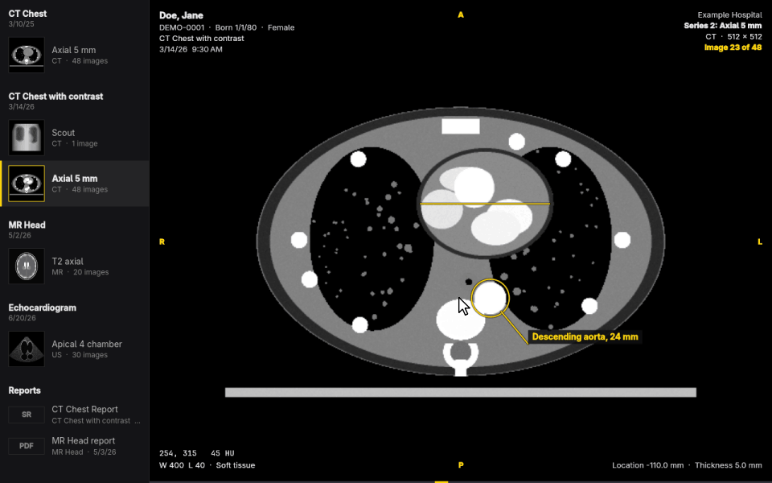
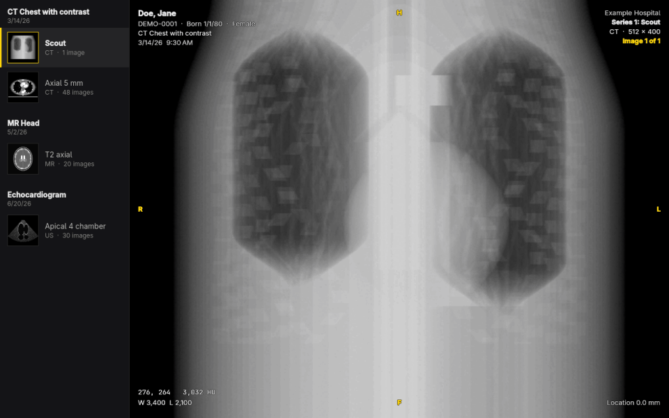
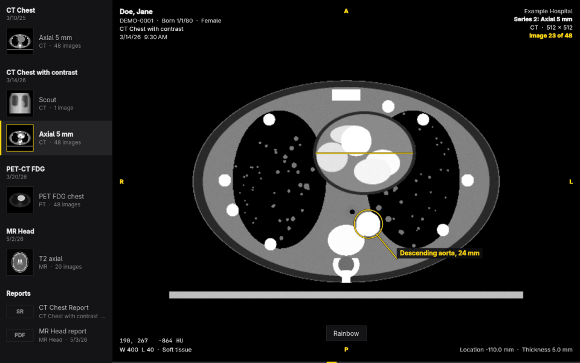
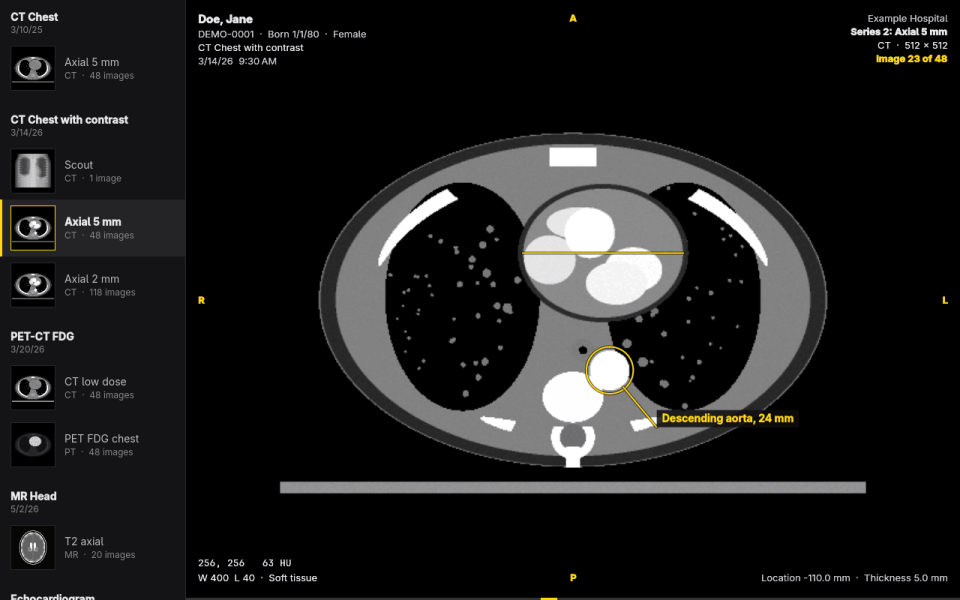
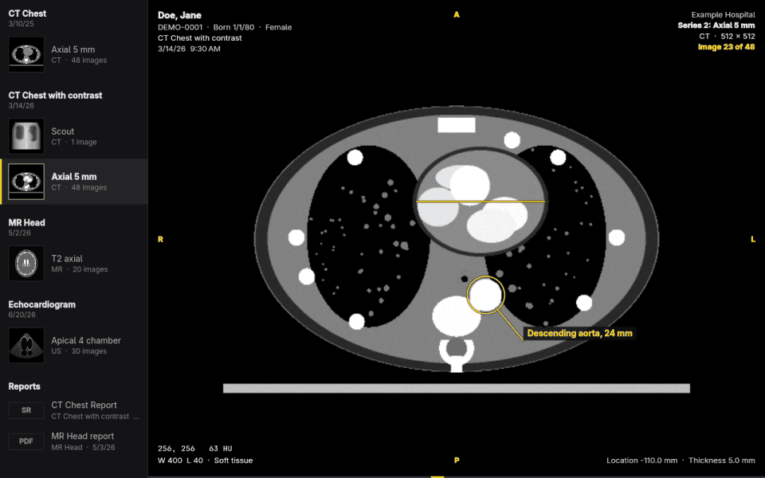

# Dicolens


<sub>A 30-second tour, with made-up scans. [Watch it as a video](docs/demo.mp4).</sub>

Dicolens is a DICOM viewer for [Omarchy](https://omarchy.org). Open the CD a
hospital gave you, a folder, or a single file, and look through it: every
series with a thumbnail, slice by slice, through the window you choose. It
follows the Omarchy theme and language as they change.

It reads CT, MR, X-ray, mammography, ultrasound, nuclear medicine, and PET:
uncompressed (little or big endian, implicit or explicit, deflated), RLE,
JPEG (baseline, extended, and lossless, with a decoder of its own), JPEG-LS,
JPEG 2000 and HTJ2K, and MPEG/H.264/HEVC video, the last few through
`ffmpeg`; grey images of 1 to 32 bits, signed or not, and RGB, YBR, and
palette colour; enhanced multi-frame files, whose spacing, position, and
rescale come frame by frame. It shows the values under the pointer (in
Hounsfield units on CT), measures in millimetres, labels the patient
directions at the image's edges, plays multi-frame series as loops, and lists
every tag.

Dicolens is for looking at your own scans. It's not for diagnosis.

## Opening scans

```sh
dicolens                  # then press O, or drop files on the window
dicolens /run/media/$USER/CDROM
dicolens IM0001.dcm       # opens the rest of its folder too, at that slice
```

A folder is read with everything under it, so a CD's root works; `DICOMDIR`
isn't needed. Files are grouped into series and studies and sorted head to
foot by where each slice is.

## What it does

Every recording here is made by `bin/demos` from made-up scans, through the
real window, so they stay true to the app as it changes.

### Open a CD or a folder



Point it at a CD, a folder, or one file. Everything under it is read, grouped
into studies and series, and each series gets a thumbnail.

### Move through the slices


The wheel or `↑` `↓` go a slice at a time, `PgUp` `PgDn` ten, and `Home`
`End` to either end. The bar along the bottom shows where you are and how much
is loaded; drag along it to go anywhere.

### Choose the window


Drag across the image for contrast, down it for brightness. `1`–`4` are the CT
windows radiologists reach for, `0` the file's own, `A` the image's full
range, `I` inverts, and `Ctrl+Z` undoes any of it.

### Zoom and move


`Ctrl`+wheel zooms about the pointer, a right-drag zooms too, a middle-drag
(or `Shift`+drag) moves the image, and `F` fits it back.

### Read values and measure



The value under the pointer shows at the bottom left, in Hounsfield units on a
CT. `M` turns on the ruler, which measures in millimetres from the file's pixel
spacing.

### Switch series, and play a loop



`←` `→` go through the series of every study. `Space` plays a series as a
loop: an ultrasound clip, or a CT run through head to foot.

### Look through the tags


`T` lists every tag of the slice shown, with sequences nested; `Ctrl+F`
searches them by name, number, or value.

### Hide the patient's details


`H` clears the image's corners, where the patient's name, ID, and birth date
are, and the window's title, for a screen share or a screenshot.

### Save or copy the image



`Ctrl+E` saves the image as you see it, at its true shape, as a PNG, through
the desktop's file chooser; `Ctrl+C` copies it.

### Every shortcut, on `?`



### Your theme and language



It follows the Omarchy theme and language as they change, light themes as
well as dark, in all 50 of Omarchy's languages, right to left where they read
that way. Scans stay on black, as they are read.

## Shortcuts

| Key | Does |
| --- | --- |
| `O` / `Shift+O` | Open files / a folder or CD |
| Wheel, `↑` `↓` | Previous / next slice |
| `PgUp` `PgDn` | Ten slices back / on |
| `Home` `End` | First / last slice |
| `←` `→` | Previous / next series |
| `Space` | Play / pause the series as a loop |
| Drag | Window: contrast across, brightness down |
| `1` `2` `3` `4` | CT windows: brain, soft tissue, lung, bone |
| `0` | The file's own window |
| `A` | The image's full range |
| `I` | Invert |
| `Ctrl+Z` / `Ctrl+Shift+Z` | Undo / redo a window change |
| `Ctrl`+wheel, right-drag | Zoom (about the pointer) |
| Middle-drag, `Shift`+drag | Move the image |
| `F` / `R` | Fit / reset the view and window |
| `M` | Measure: drag a ruler (`Esc` clears it) |
| `S` / `T` | Show or hide the series / the tags |
| `Ctrl+F` | Search the tags |
| `H` | Hide or show the patient's details |
| `Ctrl+E` / `Ctrl+C` | Save the image as a PNG / copy it |
| `?` | Every shortcut |
| `Q` | Quit |

## For agents and scripts

Commands that need no display; each takes `--json`, and exits 0 on success
and 1 on failure with the error on stderr.

```sh
dicolens info <file|folder>...                    # series, patient, study
dicolens tags <file>                              # every tag, sequences nested
dicolens export <file|folder> out.png --series 2 --slice 40 --window 40,400
dicolens export <file|folder> frames/ --all       # a whole series, 0001.png on
dicolens skill install                            # teach Claude Code to use these
```

## Building

Dicolens is C++ and Qt Quick, built with CMake. Everything it needs comes
with Omarchy.

```sh
bin/build                                 # build/dicolens
bin/test                                  # the tests, offscreen
bin/demos                                 # record docs/demos/*.gif again
cmake --install build --prefix ~/.local   # try it in the app launcher
```

The package's recipe lives in
[omarchy-pkgs](https://github.com/omacom/omarchy-pkgs), which is also where CI
reads the dependencies from.

## License

MIT. The theme watching and the portal file chooser follow
[Omacut](https://github.com/omacom-io/omacut).
