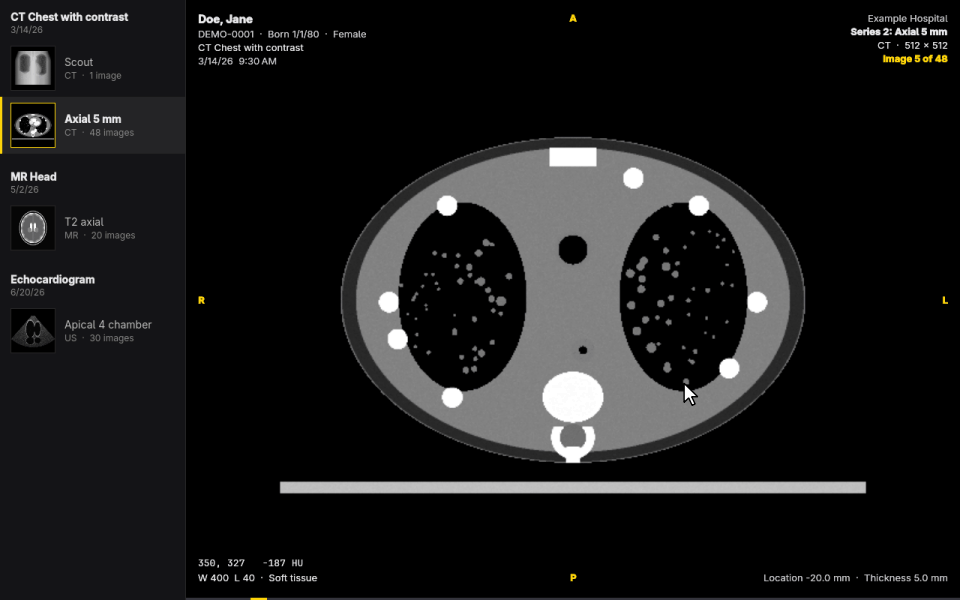
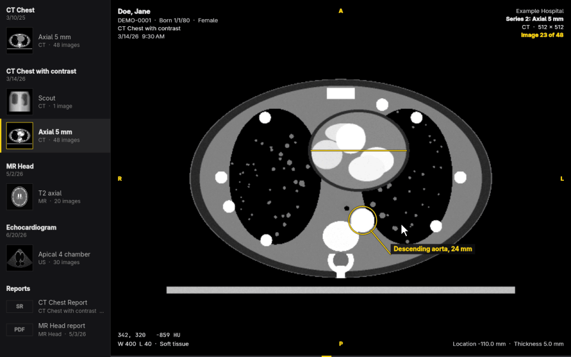
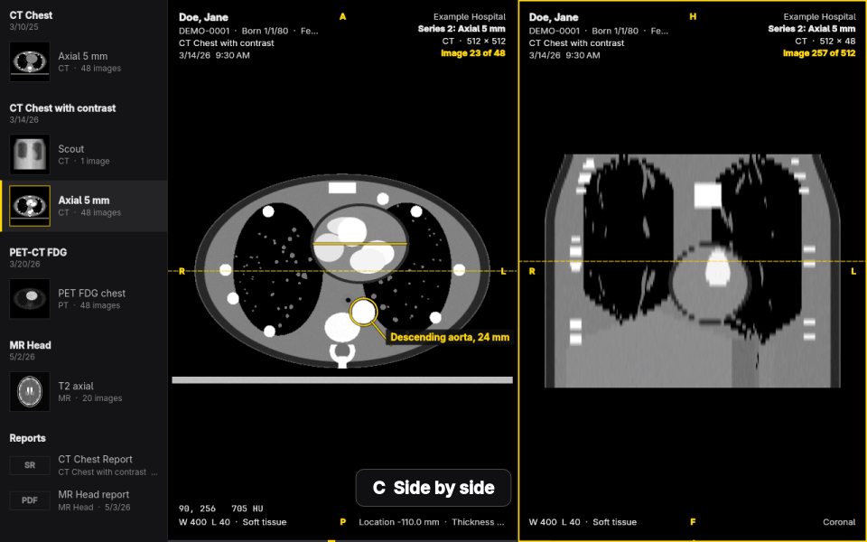
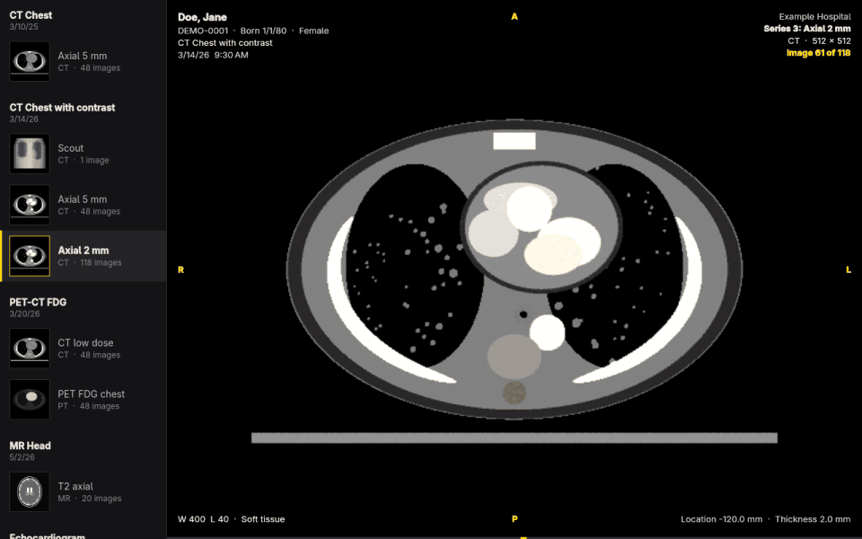
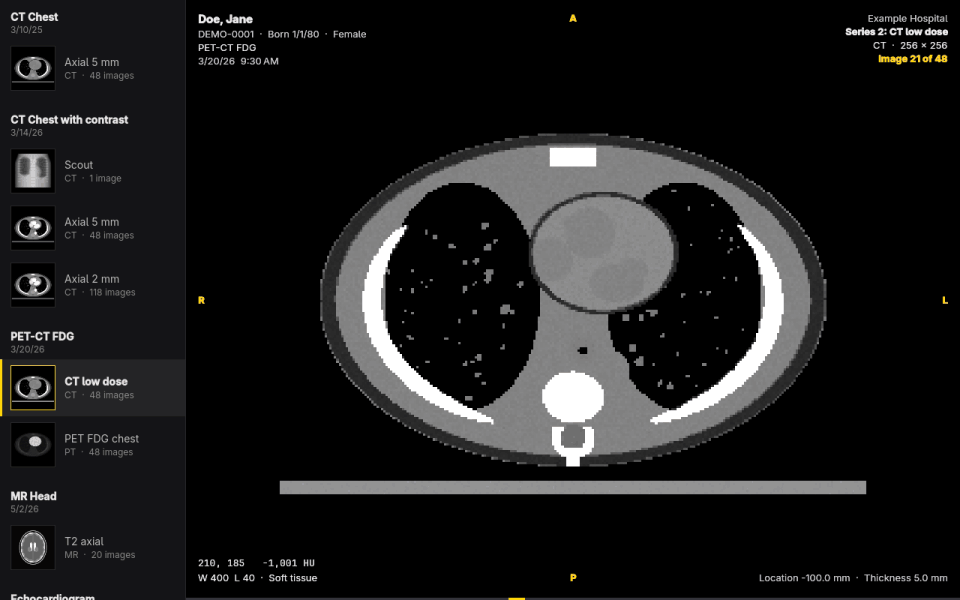
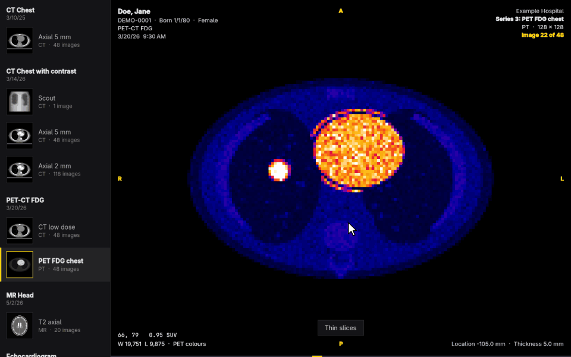
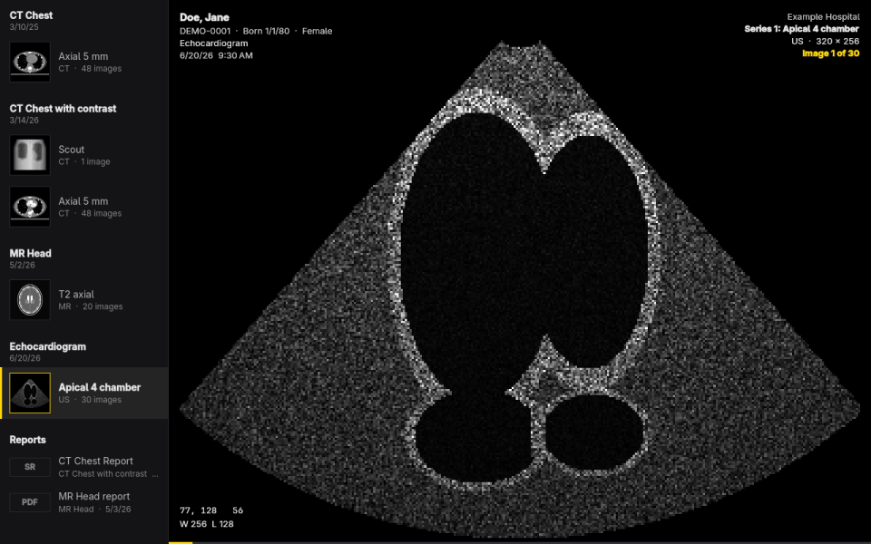
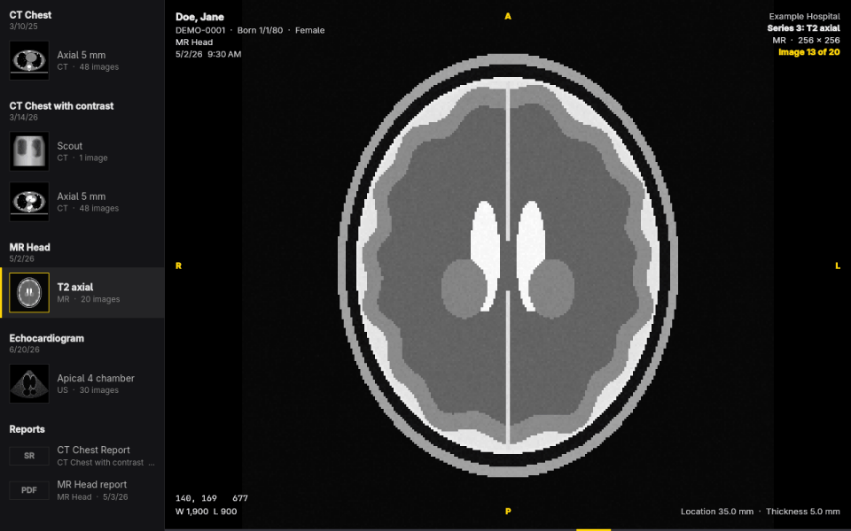

# Dicolens


<sub>A 30-second tour, with made-up scans. [Watch it as a video](docs/demo.mp4).</sub>

Dicolens is a DICOM viewer for [Omarchy](https://omarchy.org). Open the CD a
hospital gave you, a folder, or a single file, and look through it: every
series with a thumbnail, slice by slice, through the window you choose. It
follows the Omarchy theme and language as they change.

It reads CT, MR, X-ray, mammography, ultrasound, nuclear medicine, and PET:
uncompressed (little or big endian, implicit or explicit, deflated), RLE,
JPEG (baseline, extended, and lossless, with a decoder of its own), JPEG-LS,
JPEG 2000 and HTJ2K, and MPEG/H.264/HEVC video, the last few through
`ffmpeg`; grey images of 1 to 32 bits, signed or not, and RGB, YBR, and
palette colour; enhanced multi-frame files, whose spacing, position, and
rescale come frame by frame. It shows the values under the pointer (in
Hounsfield units on CT, and SUVs on PET), measures lengths, areas with their
values, angles, and Cobb angles (on ultrasound too, from the scanner's
calibration), cuts a CT or MR the other two ways, or at any angle, and into
MIP and MinIP slabs, shows it in 3D as bone, vessels, skin, or lungs, or the
three planes and 3D at once, puts a PET in colour over the CT taken with it,
labels the patient directions at the image's edges,
turns and flips the picture, plays multi-frame series as loops, and lists
every tag. It shows the marks left on the images (overlay planes and saved
annotations), reads the reports that came with them (structured reports and
PDFs), and puts two series side by side, this year's beside last year's,
scrolling together. It saves a series as a video, and an anonymous copy of the
scans to send for a second opinion.

Dicolens is for looking at your own scans. It's not for diagnosis.

## Opening scans

```sh
dicolens                  # then press O, or drop files on the window
dicolens /run/media/$USER/CDROM
dicolens IM0001.dcm       # opens the rest of its folder too, at that slice
dicolens scans.zip        # a hospital portal's download, unpacked as it's read
```

A folder is read with everything under it, so a CD's root works; `DICOMDIR`
isn't needed. Files are grouped into series and studies and sorted head to
foot by where each slice is. A zip file is unpacked into a folder of the
app's own (with `bsdtar`), which goes when the app closes.

## What it does

Every recording here is made by `bin/demos` from made-up scans, through the
real window, so they stay true to the app as it changes.

### Open a CD or a folder


Point it at a CD, a folder, or one file. Everything under it is read, grouped
into studies and series, and each series gets a thumbnail.

### Move through the slices



The wheel or `↑` `↓` go a slice at a time, `PgUp` `PgDn` ten, and `Home`
`End` to either end. The bar along the bottom shows where you are and how much
is loaded; drag along it to go anywhere.

### Choose the window



Drag across the image for contrast, down it for brightness. `1`–`4` are the CT
windows radiologists reach for, `0` the file's own, `A` the image's full
range, `I` inverts, and `Ctrl+Z` undoes any of it.

### Zoom and move


`Ctrl`+wheel zooms about the pointer, a right-drag zooms too, a middle-drag
(or `Shift`+drag) moves the image, and `F` fits it back.

### Read values and measure


The value under the pointer shows at the bottom left, in Hounsfield units on a
CT. `M` draws rulers, which measure in millimetres from the file's pixel
spacing. `E` draws an ellipse and gives its area and the mean, spread, and
range of the values in it, which on a CT tells fluid from fat or tissue.
`Shift+M` measures an angle: drag one arm, then click where the other ends.
`Shift+C` measures a Cobb angle, the curve of a spine: drag a line along the
end plate of the vertebra at one end of the curve, then along the other, and
it gives the angle between them, whichever way each was drawn.
Measurements stay on their slice, and are kept with the series: open the scans
again, even from another copy, and they're there. They're saved in Dicolens'
own folder, never beside the scans, and `dicolens measurements` lists them
with what each comes to. `Delete` removes the last one, and `Shift+Delete`
all of the slice's.

### Cut it the other ways


`V` rebuilds a CT or MR stack as coronal and sagittal planes, and back as it
was scanned, through the same point. Side by side, a dashed line on each side
shows where the other side's picture cuts it. It takes a stack of evenly
spaced, parallel slices, which most CT and MR series are.

### Cut it at any angle



A click on the picture marks where the planes meet, with a small cross, and
the other planes go through it, whichever way they're shown; side by side,
the other side moves there too. Dragging the dashed line turns the other
side's plane about that point, to follow a vessel or a bone that runs at an
angle. `Ctrl` and the arrows tilt the plane in view, 5° a press, up and down
or left and right. A tilted plane is still shown the usual way up, the head
at the top and the patient's right on the left. `V` straightens it again.

### See it in 3D



`D` shows a CT or MR stack in 3D. Dragging turns it; `B` goes through bone,
vessels, skin, lungs, and a MIP (on MR, a surface and a MIP, through the
window); `Ctrl` and a drag shows more or less of it, as the window does on a
slice. The wheel and the arrow keys cut into it from the front, to see
inside, and `Home` puts the front back. `V` looks at it from the front, the
patient's left, the back, the right, and above; `Ctrl` and the arrows turn it
a little, `]` and `[` a quarter, and `Space` spins it. A click on it marks
where the planes meet. `Ctrl+E` and `Ctrl+C` save or copy the picture. It's
drawn on the processor, roughly while it moves and finely when it stops, and
looks best from thin slices.

### Four views


`Shift+V` shows the series as it was scanned, cut coronally and sagittally,
and in 3D, at once, each with a cross where the planes meet. A click in any
of them, the 3D view too, moves the others there. `Tab` gives the keys to the
next view, and the window follows from one to the others.

### A PET over its CT



`U` puts the PET taken with a CT or MR over it, in colour, lined up by where
each was in the scanner. It's there in every plane and over the 3D view, and
the value under the pointer gives the PET's SUV beside the CT's HU.
`Shift+U` shows it at 30, 50, 70 or 100 %. Open the PET itself and `U` puts
it over the CT instead.

### Slabs: MIP and MinIP


`B` shows a slab of slices as one picture: its brightest value at each point
(a MIP, which brings out vessels and lung nodules), its darkest (a MinIP, for
the airways), or their average. `Shift+B` makes it 5, 10, 20, or 40 mm thick.
It works on the other planes too.

### PET: colours and SUVs



PET opens in colour, and shows standardised uptake values (by body weight)
under the pointer and in areas, worked out from the dose, the time it was
given, and the patient's weight in the file. `G` goes through the colour
scales, for nuclear medicine too.

### Measure on ultrasound



Ultrasound files rarely give a pixel spacing; they calibrate the picture's
area instead. The ruler uses that, so it measures in millimetres on an echo
too, as long as the line stays inside the calibrated area.

### Turn and flip



`]` and `[` turn the picture a quarter turn, `X` flips it left to right and `Y`
top to bottom, and the patient directions at the edges turn with it. `R` puts
it back. Saving and copying keep the turn.

### See the marks left on it


What someone marked on the images shows over them in the accent colour: the
outlines, lines, and notes saved as presentation states beside the images,
and the overlay planes inside the files themselves. `N` hides and shows them.

### Read the reports


A CD often carries the radiologist's report. They're listed under the series,
and `P` opens the one for the study shown: a structured report as its
findings, a PDF in your PDF viewer. `←` `→` go to the other reports, and `Esc`
back to the scans.

### Compare side by side


`C` puts a second series beside the one shown: the same kind of scan from
another study, the nearest in time, or else the next series. The sides scroll
together, matched by where each slice is in the body; `L` lets them go apart.
`Tab` (or a click) chooses the side the keys work on, and `←` `→` change its
series.

### Switch series, and play a loop


`←` `→` go through the series of every study. `Space` plays a series as a
loop: an ultrasound clip, or a CT run through head to foot.

### Look through the tags


`T` lists every tag of the slice shown, with sequences nested; `Ctrl+F`
searches them by name, number, or value.

### Hide the patient's details


`H` clears the image's corners, where the patient's name, ID, and birth date
are, and the window's title, for a screen share or a screenshot.

### Save or copy the image


`Ctrl+E` saves the image as you see it, at its true shape, as a PNG, through
the desktop's file chooser; `Ctrl+C` copies it. `Ctrl+Shift+E` saves the
whole series (or plane, or slab) as an MP4, as it's shown.

### Save an anonymous copy


`Ctrl+Shift+S` copies every image into a new folder, "Anonymous scans",
without the patient's name, IDs, birth date, address, or the people and
institution who saw them, and with new UIDs, following DICOM's Basic
Confidentiality Profile. Dates, age, sex, and weight stay, as reading the scans
needs them. Reports are left out, as their text names the patient. Some
images, ultrasound and screen captures especially, can show the name in the
picture itself, which no copy can take out; Dicolens says how many might, so
you can look before sending them.

### Every shortcut, on `?`


### Your theme and language


It follows the Omarchy theme and language as they change, light themes as
well as dark, in all 50 of Omarchy's languages, right to left where they read
that way. Scans stay on black, as they are read.

## Shortcuts

| Key | Does |
| --- | --- |
| `O` / `Shift+O` | Open files / a folder or CD |
| Wheel, `↑` `↓` | Previous / next slice |
| `PgUp` `PgDn` | Ten slices back / on |
| `Home` `End` | First / last slice |
| `←` `→` | Previous / next series |
| `Space` | Play / pause the series as a loop; in 3D, spin it |
| Drag | Window: contrast across, brightness down |
| `1` `2` `3` `4` | CT windows: brain, soft tissue, lung, bone |
| `0` | The file's own window |
| `A` | The image's full range |
| `I` | Invert |
| `Ctrl+Z` / `Ctrl+Shift+Z` | Undo / redo a window change |
| `Ctrl`+wheel, right-drag | Zoom (about the pointer) |
| Middle-drag, `Shift`+drag | Move the image |
| `F` / `R` | Fit / reset the view and window |
| `]` / `[` | Turn right / left |
| `X` / `Y` | Flip left to right / top to bottom |
| `M` / `E` / `Shift+M` | Measure a length / an area and its values / an angle |
| `Shift+C` | Measure a Cobb angle, between two lines |
| `Delete` / `Shift+Delete` | Remove the last measurement / the slice's |
| `V` | Cut the series another way: coronal, sagittal, as scanned |
| `Ctrl`+arrows | Tilt the cut |
| Click / drag the line | Where the planes meet / turn the other side's plane |
| `B` / `Shift+B` | Slabs: MIP, MinIP, average / their thickness |
| `D` | The series in 3D, and back |
| `Shift+V` | Four views: three planes and 3D (`Tab` the next) |
| `U` / `Shift+U` | A PET over the CT taken with it / how strongly it shows |
| `G` | Colour scales, for PET |
| `N` | Show or hide marks left on the image |
| `C` | Two series side by side |
| `Tab` | The other side |
| `L` | Scroll the sides together or apart |
| `P` | Read the reports that came with the scans (`←` `→` for others) |
| `S` / `T` | Show or hide the series / the tags |
| `Ctrl+F` | Search the tags |
| `H` | Hide or show the patient's details |
| `Ctrl+E` / `Ctrl+C` | Save the image as a PNG / copy it |
| `Ctrl+Shift+E` | Save the series as a video |
| `Ctrl+Shift+S` | Save an anonymous copy of the scans |
| `?` | Every shortcut |
| `Q` | Quit |

## For agents and scripts

Commands that need no display; each takes `--json`, and exits 0 on success
and 1 on failure with the error on stderr.

```sh
dicolens info <file|folder>...                    # series, patient, study
dicolens tags <file>                              # every tag, sequences nested
dicolens export <file|folder> out.png --series 2 --slice 40 --window 40,400
dicolens export <file|folder> frames/ --all       # a whole series, 0001.png on
dicolens export <file|folder> 3d.png --3d --look vessels --from left --cut 40
dicolens export <file|folder> out.png --series 5 --slice 20 --pet  # the PET over the CT
dicolens measurements <file|folder>               # what was measured in the viewer
dicolens report <file|folder> --report 1          # a structured report as text
dicolens report <file|folder> --out report.pdf    # or a PDF report, saved
dicolens anonymize <file|folder|zip> --out shared/  # a copy without the patient's identity
dicolens skill install                            # teach Claude Code to use these
```

## Building

Dicolens is C++ and Qt Quick, built with CMake. Everything it needs comes
with Omarchy.

```sh
bin/build                                 # build/dicolens
bin/test                                  # the tests, offscreen
bin/demos                                 # record docs/demos/*.gif again
cmake --install build --prefix ~/.local   # try it in the app launcher
```

The package's recipe lives in
[omarchy-pkgs](https://github.com/omacom/omarchy-pkgs), which is also where CI
reads the dependencies from.

## License

MIT. The theme watching and the portal file chooser follow
[Omacut](https://github.com/omacom-io/omacut).
