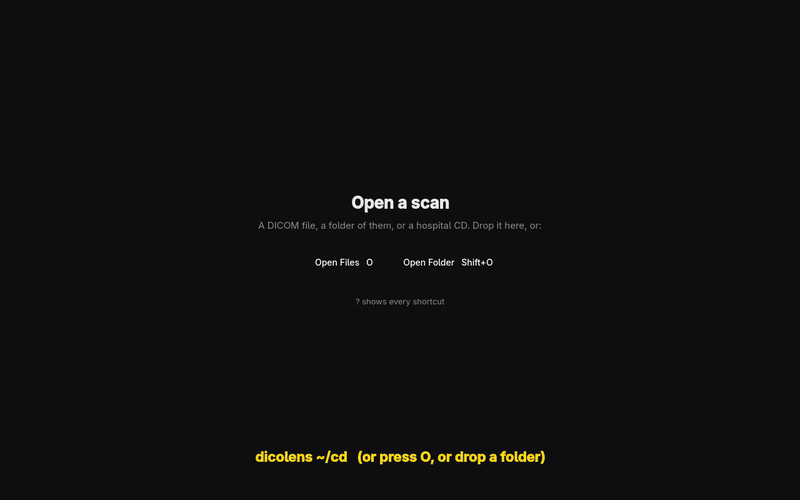

# Dicolens



<sub>A 30-second tour, with made-up scans. [Watch it as a video](docs/demo.mp4).</sub>

Dicolens is a DICOM viewer for [Omarchy](https://omarchy.org). Open the CD a
hospital gave you, a folder, or a single file, and look through it: every
series with a thumbnail, slice by slice, through the window you choose. It
follows the Omarchy theme and language as they change.

It reads CT, MR, X-ray, mammography, ultrasound, nuclear medicine, and PET:
uncompressed (little or big endian, implicit or explicit, deflated), RLE,
JPEG (baseline, extended, and lossless, with a decoder of its own), JPEG-LS,
JPEG 2000 and HTJ2K, and MPEG/H.264/HEVC video, the last few through
`ffmpeg`; grey images of 1 to 32 bits, signed or not, and RGB, YBR, and
palette colour; enhanced multi-frame files, whose spacing, position, and
rescale come frame by frame. It shows the values under the pointer (in
Hounsfield units on CT, and SUVs on PET), measures lengths, areas with their
values, angles, and Cobb angles (on ultrasound too, from the scanner's
calibration), cuts a CT or MR the other two ways, or at any angle, and into
MIP and MinIP slabs, shows it in 3D as bone, vessels, skin, or lungs, or the
three planes and 3D at once, puts a PET in colour over the CT taken with it,
labels the patient directions at the image's edges,
turns and flips the picture, plays multi-frame series as loops, and lists
every tag. It shows the marks left on the images (overlay planes and saved
annotations), reads the reports that came with them (structured reports and
PDFs), and puts two series side by side, this year's beside last year's,
scrolling together. It saves a series as a video, and an anonymous copy of the
scans to send for a second opinion.

Dicolens is for looking at your own scans. It's not for diagnosis.

## Opening scans

```sh
dicolens                  # then press O, or drop files on the window
dicolens /run/media/$USER/CDROM
dicolens IM0001.dcm       # opens the rest of its folder too, at that slice
dicolens scans.zip        # a hospital portal's download, unpacked as it's read
```

A folder is read with everything under it, so a CD's root works; `DICOMDIR`
isn't needed. Files are grouped into series and studies and sorted head to
foot by where each slice is. A zip file is unpacked into a folder of the
app's own (with `bsdtar`), which goes when the app closes.

## What it does

Each of these is shown with a short recording in
[docs/features.md](docs/features.md):

- [Open a CD or a folder](docs/features.md#open-a-cd-or-a-folder)
- [Move through the slices](docs/features.md#move-through-the-slices)
- [Choose the window](docs/features.md#choose-the-window)
- [Zoom and move](docs/features.md#zoom-and-move)
- [Read values and measure](docs/features.md#read-values-and-measure)
- [Cut it the other ways](docs/features.md#cut-it-the-other-ways)
- [Cut it at any angle](docs/features.md#cut-it-at-any-angle)
- [See it in 3D](docs/features.md#see-it-in-3d)
- [Four views](docs/features.md#four-views)
- [A PET over its CT](docs/features.md#a-pet-over-its-ct)
- [Slabs: MIP and MinIP](docs/features.md#slabs-mip-and-minip)
- [PET: colours and SUVs](docs/features.md#pet-colours-and-suvs)
- [Measure on ultrasound](docs/features.md#measure-on-ultrasound)
- [Turn and flip](docs/features.md#turn-and-flip)
- [See the marks left on it](docs/features.md#see-the-marks-left-on-it)
- [Read the reports](docs/features.md#read-the-reports)
- [Compare side by side](docs/features.md#compare-side-by-side)
- [Switch series, and play a loop](docs/features.md#switch-series-and-play-a-loop)
- [Look through the tags](docs/features.md#look-through-the-tags)
- [Hide the patient's details](docs/features.md#hide-the-patients-details)
- [Save or copy the image](docs/features.md#save-or-copy-the-image)
- [Save an anonymous copy](docs/features.md#save-an-anonymous-copy)
- [Every shortcut, on `?`](docs/features.md#every-shortcut-on-)
- [Your theme and language](docs/features.md#your-theme-and-language)

## Shortcuts

| Key | Does |
| --- | --- |
| `O` / `Shift+O` | Open files / a folder or CD |
| Wheel, `↑` `↓` | Previous / next slice |
| `PgUp` `PgDn` | Ten slices back / on |
| `Home` `End` | First / last slice |
| `←` `→` | Previous / next series |
| `Space` | Play / pause the series as a loop; in 3D, spin it |
| Drag | Window: contrast across, brightness down |
| `1` `2` `3` `4` | CT windows: brain, soft tissue, lung, bone |
| `0` | The file's own window |
| `A` | The image's full range |
| `I` | Invert |
| `Ctrl+Z` / `Ctrl+Shift+Z` | Undo / redo a window change |
| `Ctrl`+wheel, right-drag | Zoom (about the pointer) |
| Middle-drag, `Shift`+drag | Move the image |
| `F` / `R` | Fit / reset the view and window |
| `]` / `[` | Turn right / left |
| `X` / `Y` | Flip left to right / top to bottom |
| `M` / `E` / `Shift+M` | Measure a length / an area and its values / an angle |
| `Shift+C` | Measure a Cobb angle, between two lines |
| `Delete` / `Shift+Delete` | Remove the last measurement / the slice's |
| `V` | Cut the series another way: coronal, sagittal, as scanned |
| `Ctrl`+arrows | Tilt the cut |
| Click / drag the line | Where the planes meet / turn the other side's plane |
| `B` / `Shift+B` | Slabs: MIP, MinIP, average / their thickness |
| `D` | The series in 3D, and back |
| `Shift+V` | Four views: three planes and 3D (`Tab` the next) |
| `U` / `Shift+U` | A PET over the CT taken with it / how strongly it shows |
| `G` | Colour scales, for PET |
| `N` | Show or hide marks left on the image |
| `C` | Two series side by side |
| `Tab` | The other side |
| `L` | Scroll the sides together or apart |
| `P` | Read the reports that came with the scans (`←` `→` for others) |
| `S` / `T` | Show or hide the series / the tags |
| `Ctrl+F` | Search the tags |
| `H` | Hide or show the patient's details |
| `Ctrl+E` / `Ctrl+C` | Save the image as a PNG / copy it |
| `Ctrl+Shift+E` | Save the series as a video |
| `Ctrl+Shift+S` | Save an anonymous copy of the scans |
| `?` | Every shortcut |
| `Q` | Quit |

## For agents and scripts

Commands that need no display; each takes `--json`, and exits 0 on success
and 1 on failure with the error on stderr.

```sh
dicolens info <file|folder>...                    # series, patient, study
dicolens tags <file>                              # every tag, sequences nested
dicolens export <file|folder> out.png --series 2 --slice 40 --window 40,400
dicolens export <file|folder> frames/ --all       # a whole series, 0001.png on
dicolens export <file|folder> 3d.png --3d --look vessels --from left --cut 40
dicolens export <file|folder> out.png --series 5 --slice 20 --pet  # the PET over the CT
dicolens measurements <file|folder>               # what was measured in the viewer
dicolens report <file|folder> --report 1          # a structured report as text
dicolens report <file|folder> --out report.pdf    # or a PDF report, saved
dicolens anonymize <file|folder|zip> --out shared/  # a copy without the patient's identity
dicolens skill install                            # teach Claude Code to use these
```

## Building

Dicolens is C++ and Qt Quick, built with CMake. Everything it needs comes
with Omarchy.

```sh
bin/build                                 # build/dicolens
bin/test                                  # the tests, offscreen
bin/demos                                 # record the GIFs in docs/demos again
cmake --install build --prefix ~/.local   # try it in the app launcher
```

The package's recipe lives in
[omarchy-pkgs](https://github.com/omacom/omarchy-pkgs), which is also where CI
reads the dependencies from.

## License

MIT. The theme watching and the portal file chooser follow
[Omacut](https://github.com/omacom-io/omacut).
