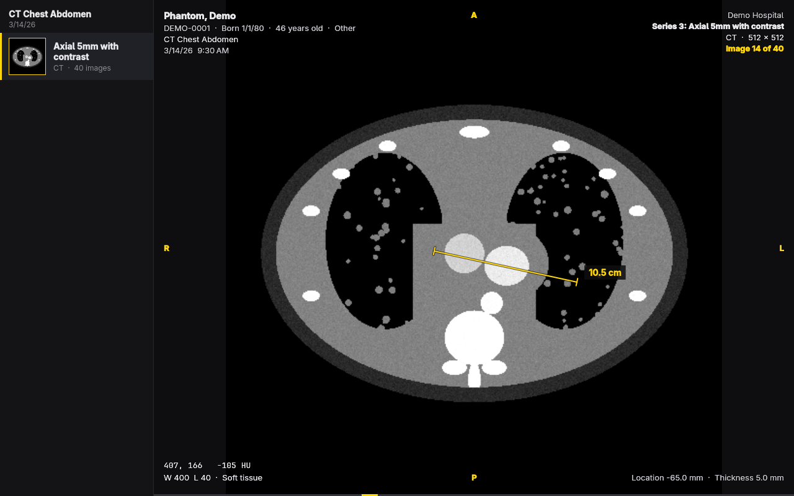

# Scans



Scans is a DICOM viewer for [Omarchy](https://omarchy.org). Open the CD a
hospital gave you, a folder, or a single file, and look through it: every
series with a thumbnail, slice by slice, through the window you choose. It
follows the Omarchy theme and language as they change.

It reads CT, MR, X-ray, mammography, ultrasound, nuclear medicine, and PET:
uncompressed and RLE images, JPEG (baseline, extended, and lossless, with a
decoder of its own), JPEG-LS, JPEG 2000 and HTJ2K, and MPEG/H.264/HEVC video,
the last few through `ffmpeg`. It shows the values under the pointer (in
Hounsfield units on CT), measures in millimetres, labels the patient
directions at the image's edges, plays multi-frame series as loops, and lists
every tag.

Scans is for looking at your own scans. It's not for diagnosis.

## Opening scans

```sh
scans                  # then press O, or drop files on the window
scans /run/media/$USER/CDROM
scans IM0001.dcm       # opens the rest of its folder too, at that slice
```

A folder is read with everything under it, so a CD's root works; `DICOMDIR`
isn't needed. Files are grouped into series and studies and sorted head to
foot by where each slice is.

## Shortcuts

| Key | Does |
| --- | --- |
| `O` / `Shift+O` | Open files / a folder or CD |
| Wheel, `↑` `↓` | Previous / next slice |
| `PgUp` `PgDn` | Ten slices back / on |
| `Home` `End` | First / last slice |
| `←` `→` | Previous / next series |
| `Space` | Play / pause the series as a loop |
| Drag | Window: contrast across, brightness down |
| `1` `2` `3` `4` | CT windows: brain, soft tissue, lung, bone |
| `0` | The file's own window |
| `A` | The image's full range |
| `I` | Invert |
| `Ctrl+Z` / `Ctrl+Shift+Z` | Undo / redo a window change |
| `Ctrl`+wheel, right-drag | Zoom (about the pointer) |
| Middle-drag, `Shift`+drag | Move the image |
| `F` / `R` | Fit / reset the view and window |
| `M` | Measure: drag a ruler (`Esc` clears it) |
| `S` / `T` | Show or hide the series / the tags |
| `Ctrl+F` | Search the tags |
| `H` | Hide or show the patient's details |
| `Ctrl+E` / `Ctrl+C` | Save the image as a PNG / copy it |
| `?` | Every shortcut |
| `Q` | Quit |

## For agents and scripts

Commands that need no display; each takes `--json`, and exits 0 on success
and 1 on failure with the error on stderr.

```sh
scans info <file|folder>...                    # series, patient, study
scans tags <file>                              # every tag, sequences nested
scans export <file|folder> out.png --series 2 --slice 40 --window 40,400
scans export <file|folder> frames/ --all       # a whole series, 0001.png on
scans skill install                            # teach Claude Code to use these
```

## Building

Scans is C++ and Qt Quick, built with `qmake6`. Everything it needs comes
with Omarchy.

```sh
bin/build      # build/scans
bin/test       # the tests, offscreen
bin/install    # package and install, so it's in the app launcher
```

## License

MIT. The theme watching and the portal file chooser follow
[Omacut](https://github.com/omacom-io/omacut).
