# What Dicolens does

Every recording here is made by `bin/demos` from made-up scans, through the
real window, so they stay true to the app as it changes.

## Open a CD or a folder

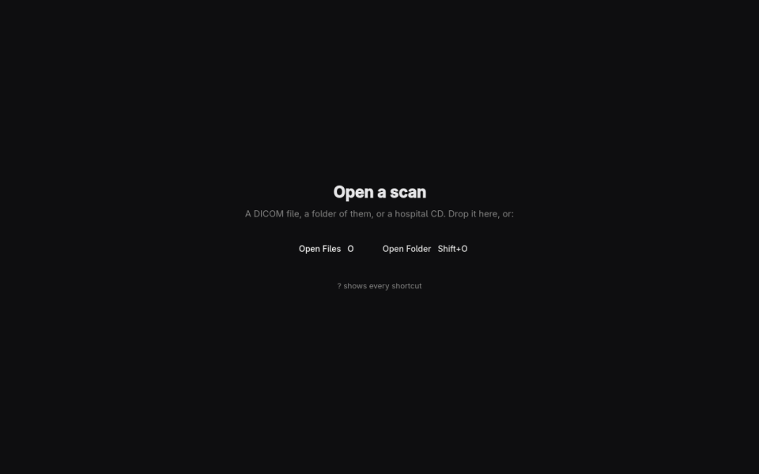

Point it at a CD, a folder, or one file. Everything under it is read, grouped
into studies and series, and each series gets a thumbnail.

## Move through the slices

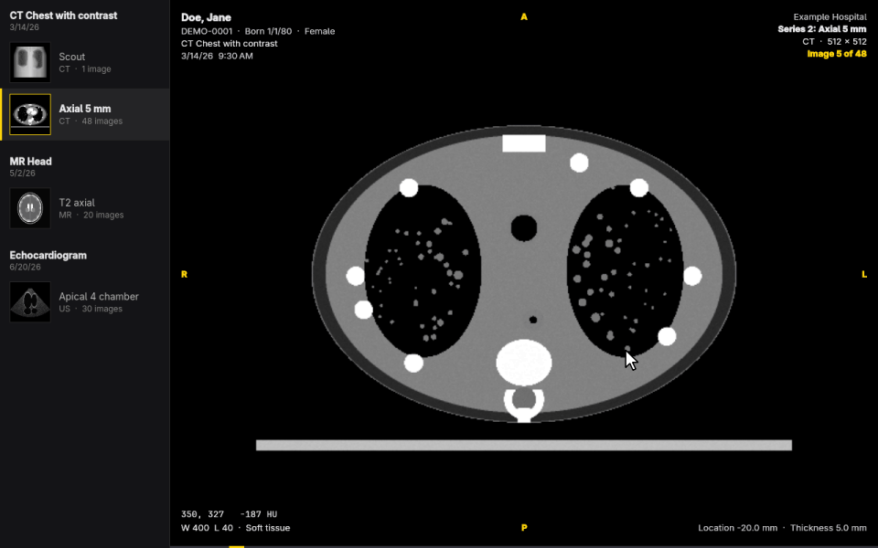

The wheel or `↑` `↓` go a slice at a time, `PgUp` `PgDn` ten, and `Home`
`End` to either end. The bar along the bottom shows where you are and how much
is loaded; drag along it to go anywhere.

## Choose the window

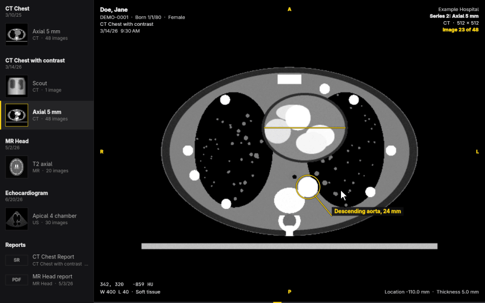

Drag across the image for contrast, down it for brightness. `1`–`4` are the CT
windows radiologists reach for, `0` the file's own, `A` the image's full
range, `I` inverts, and `Ctrl+Z` undoes any of it.

## Zoom and move

`Ctrl`+wheel zooms about the pointer, a right-drag zooms too, a middle-drag
(or `Shift`+drag) moves the image, and `F` fits it back.

## Read values and measure

The value under the pointer shows at the bottom left, in Hounsfield units on a
CT. `M` draws rulers, which measure in millimetres from the file's pixel
spacing. `E` draws an ellipse and gives its area and the mean, spread, and
range of the values in it, which on a CT tells fluid from fat or tissue.
`Shift+M` measures an angle: drag one arm, then click where the other ends.
`Shift+C` measures a Cobb angle, the curve of a spine: drag a line along the
end plate of the vertebra at one end of the curve, then along the other, and
it gives the angle between them, whichever way each was drawn.
Measurements stay on their slice, and are kept with the series: open the scans
again, even from another copy, and they're there. They're saved in Dicolens'
own folder, never beside the scans, and `dicolens measurements` lists them
with what each comes to. `Delete` removes the last one, and `Shift+Delete`
all of the slice's.

## Cut it the other ways

`V` rebuilds a CT or MR stack as coronal and sagittal planes, and back as it
was scanned, through the same point. Side by side, a dashed line on each side
shows where the other side's picture cuts it. It takes a stack of evenly
spaced, parallel slices, which most CT and MR series are. A CT taken with
its gantry tilted is one too: its slices are put where they lie, so nothing
comes out sheared, and lengths through the stack read true.

## Cut it at any angle

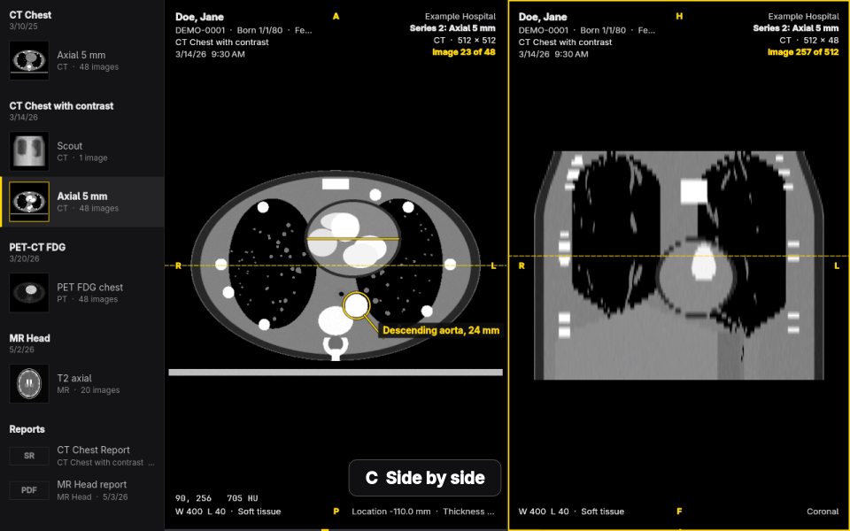

A click on the picture marks where the planes meet, with a small cross, and
the other planes go through it, whichever way they're shown; side by side,
the other side moves there too. Dragging the dashed line turns the other
side's plane about that point, to follow a vessel or a bone that runs at an
angle. `Ctrl` and the arrows tilt the plane in view, 5° a press, up and down
or left and right. A tilted plane is still shown the usual way up, the head
at the top and the patient's right on the left. `V` straightens it again.

## See it in 3D

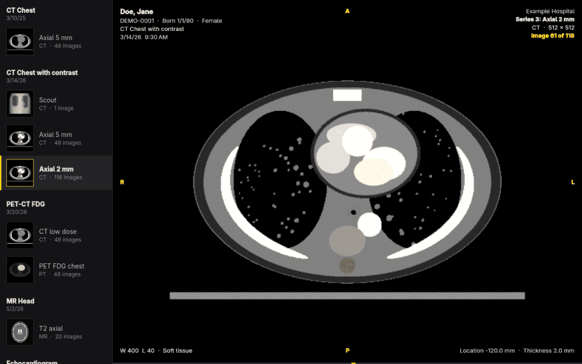

`D` shows a CT or MR stack in 3D. Dragging turns it; `B` goes through bone,
vessels, skin, lungs, and a MIP (on MR, a surface and a MIP, through the
window); `Ctrl` and a drag shows more or less of it, as the window does on a
slice. The wheel and the arrow keys cut into it from the front, to see
inside, and `Home` puts the front back. `V` looks at it from the front, the
patient's left, the back, the right, and above; `Ctrl` and the arrows turn it
a little, `]` and `[` a quarter, and `Space` spins it. A click on it marks
where the planes meet. `Ctrl+E` and `Ctrl+C` save or copy the picture. It's
drawn on the processor, roughly while it moves and finely when it stops, and
looks best from thin slices.

## Four views

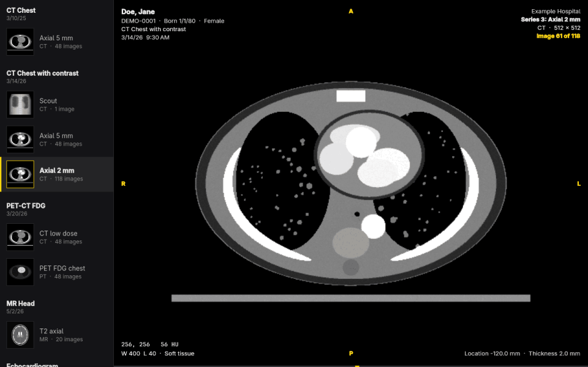

`Shift+V` shows the series as it was scanned, cut coronally and sagittally,
and in 3D, at once, each with a cross where the planes meet. A click in any
of them, the 3D view too, moves the others there. `Tab` gives the keys to the
next view, and the window follows from one to the others.

## A PET over its CT

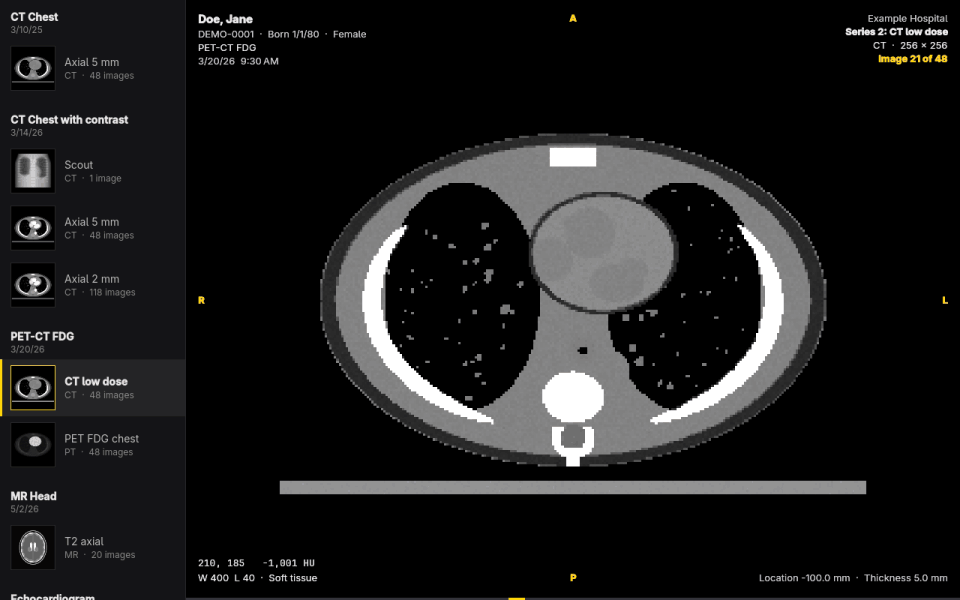

`U` puts the PET taken with a CT or MR over it, in colour, lined up by where
each was in the scanner. It's there in every plane and over the 3D view, and
the value under the pointer gives the PET's SUV beside the CT's HU.
`Shift+U` shows it at 30, 50, 70 or 100 %. Open the PET itself and `U` puts
it over the CT instead.

## Slabs: MIP and MinIP

`B` shows a slab of slices as one picture: its brightest value at each point
(a MIP, which brings out vessels and lung nodules), its darkest (a MinIP, for
the airways), or their average. `Shift+B` makes it 5, 10, 20, or 40 mm thick.
It works on the other planes too.

## PET: colours and SUVs

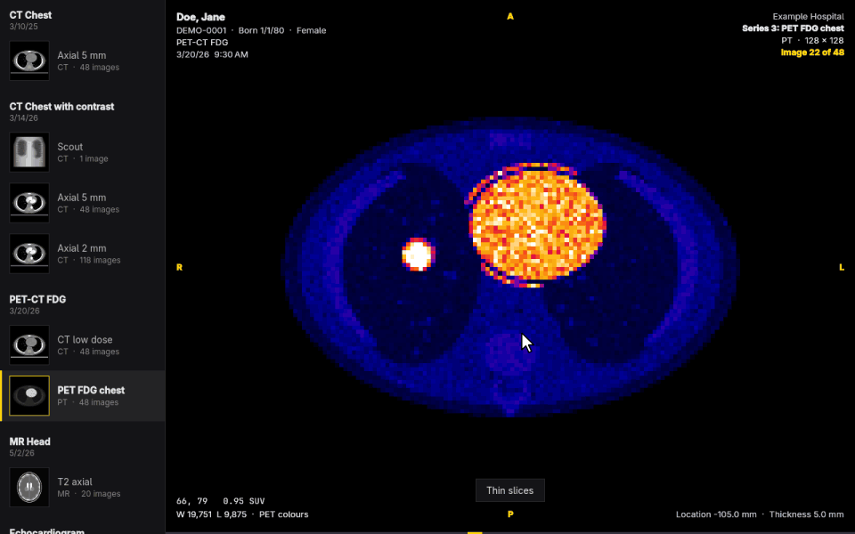

PET opens in colour, and shows standardised uptake values (by body weight)
under the pointer and in areas, worked out from the dose, the time it was
given, and the patient's weight in the file. `G` goes through the colour
scales, for nuclear medicine too.

## Measure on ultrasound

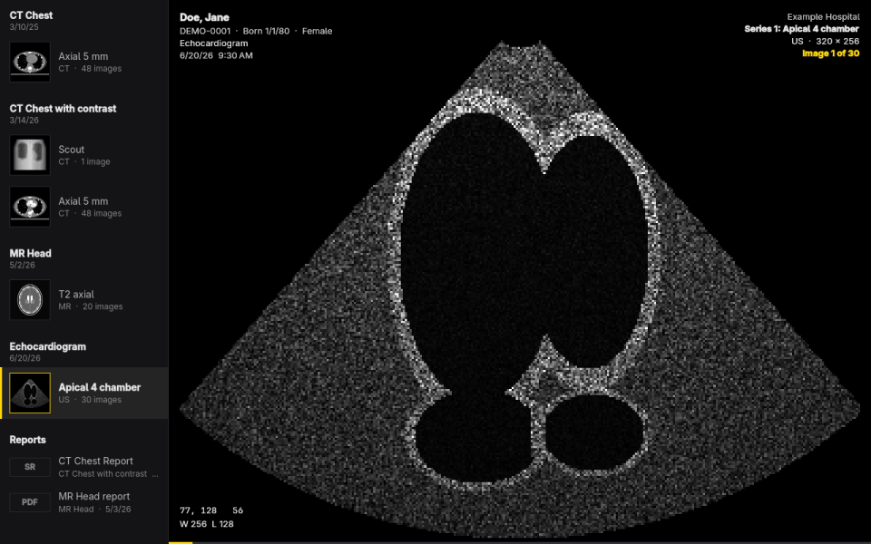

Ultrasound files rarely give a pixel spacing; they calibrate the picture's
area instead. The ruler uses that, so it measures in millimetres on an echo
too, as long as the line stays inside the calibrated area.

## Turn and flip

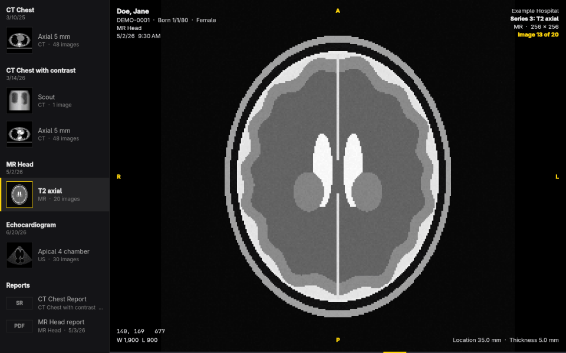

`]` and `[` turn the picture a quarter turn, `X` flips it left to right and `Y`
top to bottom, and the patient directions at the edges turn with it. `R` puts
it back. Saving and copying keep the turn.

## See the marks left on it

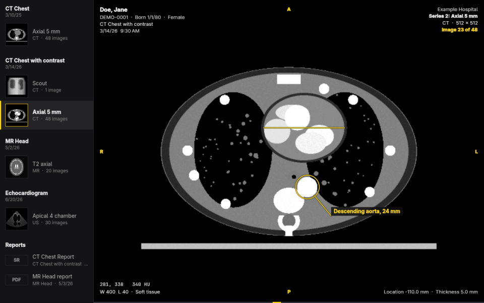

What someone marked on the images shows over them in the accent colour: the
outlines, lines, and notes saved as presentation states beside the images,
and the overlay planes inside the files themselves. `N` hides and shows them.

## Read the reports

A CD often carries the radiologist's report. They're listed under the series,
and `P` opens the one for the study shown: a structured report as its
findings, a PDF in your PDF viewer. `←` `→` go to the other reports, and `Esc`
back to the scans.

## Compare side by side

`C` puts a second series beside the one shown: the same kind of scan from
another study, the nearest in time, or else the next series. The sides scroll
together, matched by where each slice is in the body; `L` lets them go apart.
`Tab` (or a click) chooses the side the keys work on, and `←` `→` change its
series.

## Switch series, and play a loop

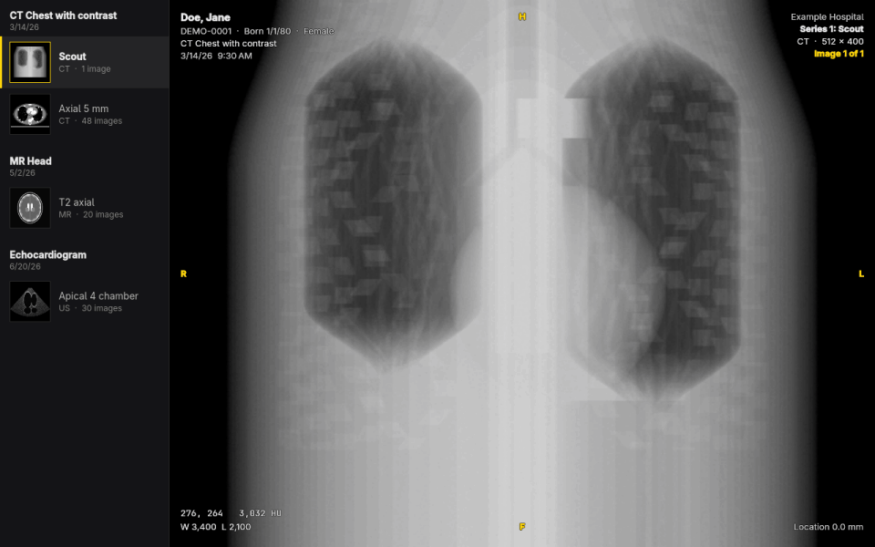

`←` `→` go through the series of every study. `Space` plays a series as a
loop: an ultrasound clip, or a CT run through head to foot.

## Look through the tags

`T` lists every tag of the slice shown, with sequences nested; `Ctrl+F`
searches them by name, number, or value.

## Hide the patient's details

`H` clears the image's corners, where the patient's name, ID, and birth date
are, and the window's title, for a screen share or a screenshot.

## Save or copy the image

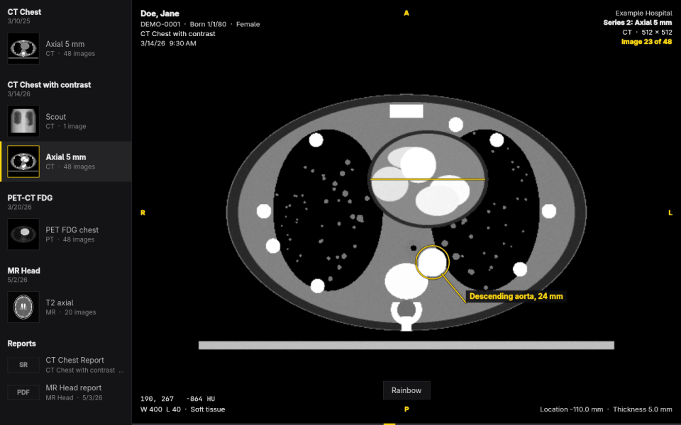

`Ctrl+E` saves the image as you see it, at its true shape, as a PNG, through
the desktop's file chooser; `Ctrl+C` copies it. `Ctrl+Shift+E` saves the
whole series (or plane, or slab) as an MP4, as it's shown.

## Save an anonymous copy

`Ctrl+Shift+S` copies every image into a new folder, "Anonymous scans",
without the patient's name, IDs, birth date, address, or the people and
institution who saw them, and with new UIDs, following DICOM's Basic
Confidentiality Profile attribute by attribute, from the standard's own
table. Dates, age, sex, and weight stay, as reading the scans needs them. The
descriptions people typed for the study and its series go, as the profile
says. Reports and saved annotations are left out, as their text names the
patient.

Each copy is read back and searched for the names, IDs, birth date,
institution, addresses, and serial numbers the originals held; a copy that
still has any of them isn't kept, and Dicolens says which file and where.

Some images, ultrasound and screen captures especially, can show the name in
the picture itself; Dicolens says how many might, so you can look before
sending them. From the command line, `dicolens anonymize` can black a
rectangle out of every image of a series (`--blackout`), keep the study's and
series' descriptions (`--keep-descriptions`), and say what a copy would
remove and keep without making one (`--dry-run`).

## Every shortcut, on `?`

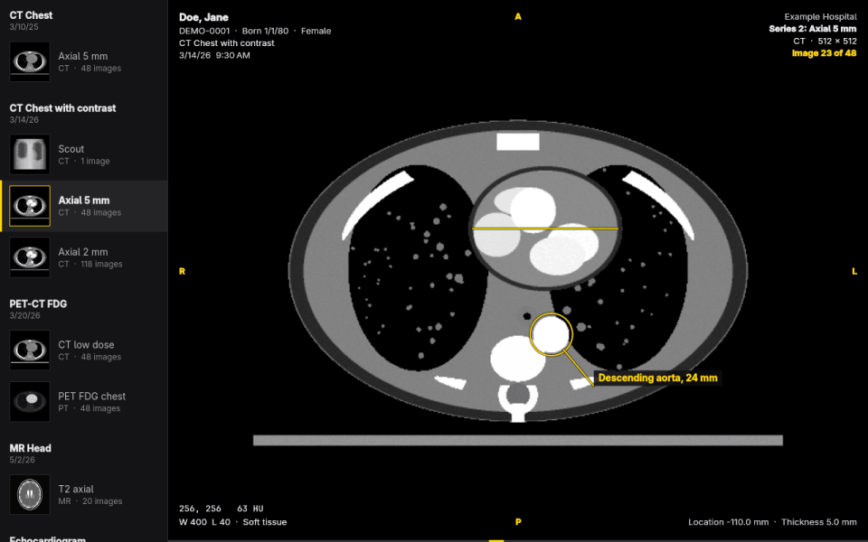

## Your theme and language

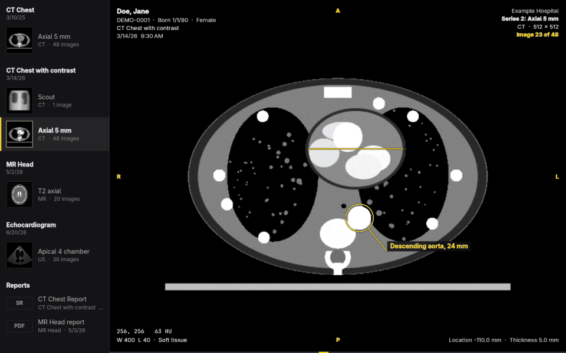

It follows the Omarchy theme and language as they change, light themes as
well as dark, in all 50 of Omarchy's languages, right to left where they read
that way. Scans stay on black, as they are read.

Every shortcut is in the [README](../README.md#shortcuts), and the commands for scripts and agents under [For agents and scripts](../README.md#for-agents-and-scripts).
